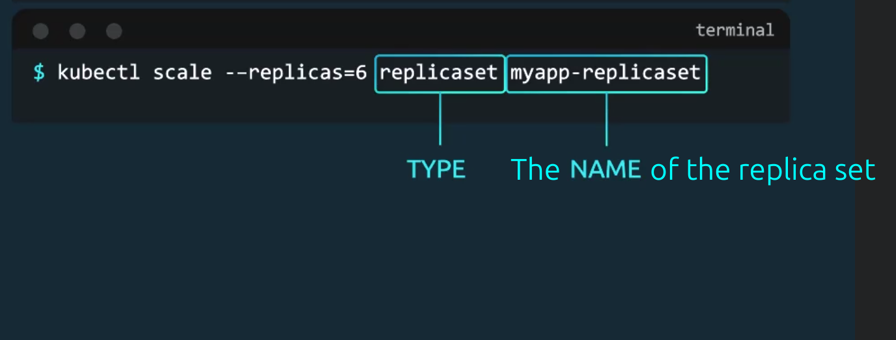

# Replication

In Kubernetes the role of [ReplicaSet](#replicaset)/[ReplicationController](#replicationcontroller) is to ensure we have always X pod up and running.

## ReplicationController

```shell
kubectl create -f rc-definition.yaml
kubectl get replicattioncontroller
kubectl get pods
```
## ReplicaSet

It selects the pods it needs to monitor and keep an eye on through labels. And replica set uses the template section in the yaml file to start a new pod when one of the pods fail.

```shell
kubectl apply -f rs-definition.yaml
kubectl scale --replicas=6 -f rs-definition.yaml # overrides the replicas directive in the yaml file. 
```



Here are some useful commands:

```shell
kubectl create -f rs-definition.yaml # You can use either apply or create
kubectl get name-of-replicaset
kubectl delete replicaset name-of-replicaset # It will delete all the pods it created for the replica set while deleting the replica set
kubectl replace -f new-rs-definition.yaml
kubectl get replicasets.apps
```

> [!TIP]
>
> You can always edit a replicaset configuration live by using this command: `kubectl edit replicaset replicaset-name`
>
> Keep in mind this is a in memory file k8s creates for itself and won'r be persisted. But changes there are applied immediately.