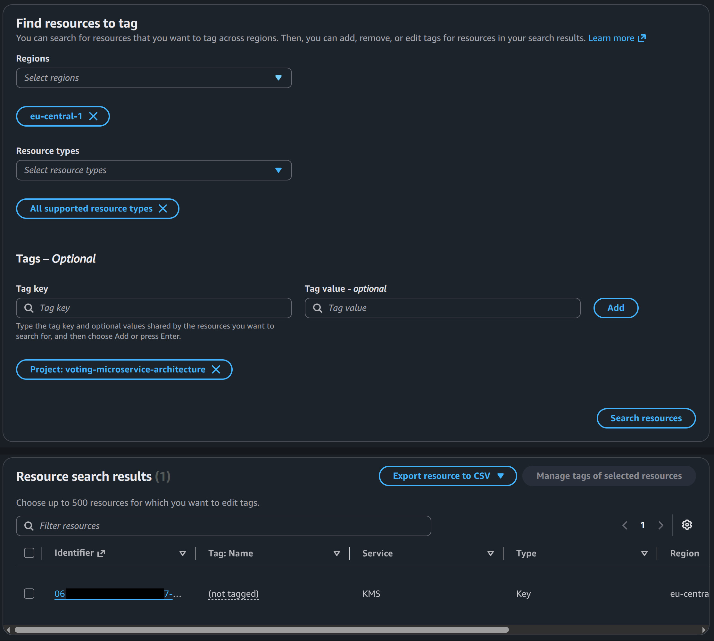

# [Elastic Kubernetes Service](https://aws.amazon.com/eks)

This creates everything needed to run the manifests in `./k8s/voting-microservice-architecture/deployment` on AWS, starting no existing EKS cluster, no VPC. Terraform builds:

- A VPC with public + private subnets across 2 AZs, a NAT gateway.
- An [EKS control plane](https://docs.aws.amazon.com/eks/latest/best-practices/control-plane.html).
- An EKS managed node group (the EC2 instances your pods actually run on).
- The IAM roles the cluster and nodes need to talk to AWS.

It does **NOT** apply `db-pod.yaml`, `redis-pod.yaml`, and other application manifests written for Kubernetes. Those are applied with `kubectl` after we [deployed the App](#3-deploying-the-app). Keeping infrastructure and application manifests separate **is deliberate**, in fact this is the more common way of doing it, and it means `terraform destroy` never has to know anything about your Kubernetes resources (why that matters is explained in [Destroying Everything](#4-destroying-everything)).

## 1. What You Need from AWS First

### 1.1 An IAM Identity for Terraform

> [!IMPORTANT]
>
> **Never** use your AWS account's root user for this. Create an IAM user (or, better, an IAM role you assume via SSO or IAM Identity Center) dedicated to this work. Here I decided to go with creating a dedicated IAM user with a access key & secret.

1. [AWS Console](https://console.aws.com/) → IAM → Users → **Create user**: let's call it `terraform-voting-app`.
2. Skip console access, this identity only needs **programmatic access**.
3. Attach permissions. For a first pass, the simplest correct thing is the AWS managed policy **`AdministratorAccess`**.

   Building an exact least-privilege policy for "create a VPC + EKS cluster" is a sizeable list (EC2, EKS, IAM role/policy creation, CloudWatch Logs, KMS, Auto Scaling, ELB) but in production I believe we must must adhere to least-privilege from day one, start from AWS's own [EKS Terraform IAM policy reference](https://docs.aws.amazon.com/eks/latest/userguide/security_iam_id-based-policy-examples.html) and the permissions listed in the [terraform-aws-modules/eks](https://github.com/terraform-aws-modules/terraform-aws-eks), and expect to iterate. `terraform apply` will tell you exactly which action was denied if you're missing one.

4. Under the user → **Security credentials** → **Create access key** → choose "Command Line Interface (CLI)". Save the Access Key ID and Secret Access Key.

   When doing this you might see a warning like this in AWS Console:

   > Alternatives recommended
   >
   > - Use AWS CLI V2 and the aws login command to use your existing console credentials in the CLI. [Learn more](https://docs.aws.amazon.com/signin/latest/userguide/command-line-sign-in.html)
   > - Use AWS CloudShell, a browser-based CLI, to run commands. [Learn more](https://docs.aws.amazon.com/cloudshell/latest/userguide/welcome.html)

   But the thing is that `aws login` is **for interactive human use** tied to an SSO session that expires, and "CloudShell" is **a browser-based shell** with credentials auto-injected. So for Terraform there are two reasonable paths:

   1. Use access keys: simplest, works everywhere, but you own the responsibility of not leaking the secret key and rotating/deleting it when done.
   2. Switch to SSO: set up IAM Identity Center, then `aws configure sso --profile voting-app`, and use short-lived credentials instead. More secure, more setup.

   Here I am just gonna stick to access keys. But you can always extend the current setup to use SSO.

   This `terraform-voting-app` user is deliberately **programmatic-access-only** (no Console password), it's an automation identity, not something a human logs into a browser with. If you also want to browse pods/logs for this cluster in the AWS Console, that's a _second_, separate IAM identity, created by this same Terraform config — see [§6](#6-viewing-the-cluster-in-the-aws-console).

   Note there's no `aws configure` or `aws login` step anywhere in this guide. Those are how you'd hand credentials to a **CLI profile**. Instead, [§1.2](#12-give-terraform-those-credentials) below exports the access key/secret as the `AWS_ACCESS_KEY_ID`/`AWS_SECRET_ACCESS_KEY` **environment variables**, which every AWS tool (Terraform's `aws` provider, the `aws` CLI, and by extension `kubectl` once it's configured for IAM auth) reads automatically, no profile needed. That export **is** the auth step, for all three tools, for the rest of this guide.

### 1.2 Give Terraform those Credentials

Make sure to **not** put keys in `.tf` files or `terraform.tfvars`, instead dump them all into a env file and then `cp .env.example .env`. This way you're not gonna commit those sensitive info into your VCS.

```
cd k8s/voting-microservice-architecture/deployment/terraform
export $(cat .env | xargs)
```

This sets `AWS_ACCESS_KEY_ID`, `AWS_SECRET_ACCESS_KEY`, and `AWS_REGION` as environment variables in your shell. That's the whole authentication setup, there's no separate `aws configure` or `aws login` to run. The `aws` provider in `providers.tf` has no `access_key`/`secret_key` arguments of its own, so it falls back to the AWS SDK's standard credential chain, which checks these exact env vars first. The AWS CLI and `kubectl` (once pointed at the cluster, see [§2](#2-how-this-terraform-is-structured)) read the same env vars, so this one `export` is what authenticates `terraform apply`, `aws eks update-kubeconfig`, and every `kubectl` call later in this guide.

> [!WARNING]
>
> Keep in mind this export only lasts for the current shell session, if you open a new terminal, re-run it before running any `terraform`/`aws`/`kubectl` command in this guide.

### 1.3 Tools on your Machine

- You need to install [Terraform](https://developer.hashicorp.com/terraform/install):
  ```shell
  sudo -v
  wget -O - https://apt.releases.hashicorp.com/gpg | sudo gpg --dearmor -o /usr/share/keyrings/hashicorp-archive-keyring.gpg
  sudo apt update && sudo apt install terraform
  ```
- And [AWS CLI v2](https://docs.aws.amazon.com/cli/latest/userguide/getting-started-install.html), used to configure credentials and to fetch a `kubeconfig` after `apply`.
  ```
  sudo apt purge awscli
  sudo -v
  curl -fsSL https://awscli.amazonaws.com/v2/install.sh | sudo bash -s -- --system
  ```
- And [`kubectl`](https://kubernetes.io/docs/tasks/tools/install-kubectl-linux), used after the cluster exists, to apply k8s yaml manifests.

### 1.4 Cost Warning

This is not free-tier. You're paying for:

- The EKS control plane (~$0.10/hour).
- 2× [`t3.medium`](https://aws.amazon.com/ec2/instance-types/t3/) EC2 instances.
- 1 NAT gateway (hourly + per-GB).
- EBS volumes for the nodes.

Rough order of magnitude: a few dollars per day if left running. `voting-service`/`result-service` are `type: LoadBalancer` (see [§3](#3-deploying-the-app)), so applying the manifests on EKS provisions 2 Network Load Balancers at ~$0.0225/hour each plus per-GB processed. Small, but another thing billing while it exists. [Destroy it](#4-destroying-everything) when you're done.

---

## 2. How this Terraform is Structured

| File                       | Purpose                                                                                                                                                                                                |
| -------------------------- | ------------------------------------------------------------------------------------------------------------------------------------------------------------------------------------------------------ |
| `versions.tf`              | Pins Terraform and provider versions, so `apply` behaves the same on any machine/CI runner.                                                                                                            |
| `providers.tf`             | Configures the `aws` provider, which account/region Terraform talks to, plus tags applied to everything it creates.                                                                                    |
| `variables.tf`             | Every configurable input (region, cluster name, node sizing, ...), each with a sane default.                                                                                                           |
| `vpc.tf`                   | The `terraform-aws-modules/vpc/aws` module: VPC, subnets, route tables, NAT gateway.                                                                                                                   |
| `eks.tf`                   | The `terraform-aws-modules/eks/aws` module: control plane, IAM roles, managed node group, core add-ons (CoreDNS, kube-proxy, VPC CNI), and the read-only access entry for the Console-viewer user.     |
| `iam.tf`                   | The human, Console-only IAM user for viewing this cluster's pods/logs, see [§6](#6-viewing-the-cluster-in-the-aws-console).                                                                            |
| `data.tf`                  | Read-only data sources (currently just the account ID, used to build the Console sign-in URL output).                                                                                                  |
| `outputs.tf`               | Values printed after `apply`, cluster name, endpoint, and the exact `aws eks update-kubeconfig` command to run next.                                                                                   |
| `cleanup.tf`               | A destroy-time hook that deletes the Kubernetes-created LoadBalancer Services (`../voting-service.yaml`/`../result-service.yaml`) before the cluster/VPC teardown, see [§4](#4-destroying-everything). |
| `terraform.tfvars.example` | Copy to `terraform.tfvars` to override defaults without editing `.tf` files.                                                                                                                           |

Both `vpc.tf` and `eks.tf` use published community modules ([terraform-aws-modules](https://github.com/terraform-aws-modules)) rather than hand-rolled resources. These modules are themselves just Terraform, each one is a set of `.tf` files with `resource` blocks, versioned and published to the [Terraform Registry](https://registry.terraform.io). Using them means correct IAM trust policies, subnet tagging, and add-on wiring without reproducing hundreds of lines of boilerplate, you're still fully looking at declarative Terraform config, just one layer up.

### How Terraform Actually Works -- The Mental Model

1. **You declare desired state**. Every `.tf` file in this directory is merged into one configuration. Nothing here is imperative, a `resource` block says "this thing should exist with these attributes," not "run this command".
2. **`terraform init`** downloads the providers (`aws`) and modules (`vpc`, `eks`) that the config references, into a local `.terraform/` directory. You run this once, and again whenever you add/change a provider or module version. It also creates/checks `.terraform.lock.hcl`, which pins exact provider versions, **commit this file** so everyone/CI resolves the same versions.
3. **`terraform plan`** asks the AWS API "what currently exists that matches what I'm tracking?", compares that to what the config says should exist, and prints a diff: resources to create (`+`), change in place (`~`), or destroy (`-`). Nothing is changed on AWS by `plan`.
4. **`terraform apply`** re-runs that same diff, shown to you, asks for confirmation (`yes`), then calls the AWS API to create/update/delete resources in dependency order, e.g. it won't create the node group before the cluster and VPC it depends on exist. Terraform builds this ordering automatically from references between resources (e.g. `eks.tf` referencing `module.vpc.private_subnets`).
5. **State (`terraform.tfstate`)** is Terraform's record of what it created and the real-world IDs of those things (this VPC id, that cluster ARN, ...). This is the critical file: **Terraform only knows how to change or destroy what's in its state.** It's created in this directory on first `apply` and is gitignored on purpose since it can contain sensitive values, and two people applying against the same local state file at the same time will corrupt it. For learning use, local state is fine and that is what we have here. For a team or a real project, you'd point `versions.tf`'s [backend block at S3](https://dev.to/engabelal/did-you-know-terraform-s3-state-locking-no-dynamodb-needed-k34) (or Terraform Cloud) so state is shared and locked.

### Commands You'll Actually Run

```bash
cd k8s/voting-microservice-architecture/deployment/terraform
cp terraform.tfvars.example terraform.tfvars # 👈 Optional, to override defaults

terraform init
terraform plan
terraform apply
```

After apply finishes (use whatever `aws_region` you deployed into): THIS is the step that points kubectl at your new EKS cluster. Before this, `~/.kube/config` has no entry for it at all, so every `kubectl` command below would fail or hit the wrong cluster (e.g. minikube). So to add the cluster's API endpoint + CA cert into `~/.kube/config` and sets it as the current context, with `kubectl` authenticating via your AWS CLI credentials (IAM) on every call -- there's no SSH, no key pair, nothing to open up.

No new login/auth step is needed here, this command just reuses the same `AWS_ACCESS_KEY_ID`/`AWS_SECRET_ACCESS_KEY` env vars you exported in [§1.2](#12-give-terraform-those-credentials): it calls the EKS API (as that IAM identity) to fetch the cluster's endpoint/CA cert, and writes a `kubectl` context whose `user` entry runs `aws eks get-token` (using those same env vars) on every subsequent `kubectl` call to mint a short-lived auth token. So as long as that `export` is still active in your shell, `kubectl` "just works" against the new cluster.

```shell
aws eks update-kubeconfig --region eu-central-1 --name voting-app-cluster
```

Then to confirm nodes joined the cluster, using that new context

```shell
kubectl get nodes
```

The exact `update-kubeconfig` command is also printed as the `configure_kubectl` output at the end of `apply`, so you don't have to remember cluster name/region by hand.

Note there is no SSH access anywhere in this picture. The EKS control plane is a fully AWS-managed API server with no shell access at all. The worker node EC2 instances _could_ have SSH enabled via a key pair on the node group, but this Terraform doesn't configure one, and the nodes sit in private subnets with no public IP (`vpc.tf`), so there would be no route in even if a key existed. `kubectl`, authenticated via IAM through the command above, is the only access path.

> [!NOTE]
>
> `update-kubeconfig` merges in a new **context** and switches to it, it does not remove your existing minikube/whatever context if you have one. Both live side by side in `~/.kube/config`:
>
> ```bash
> kubectl config get-contexts          # list all contexts, * marks the current one
> kubectl config use-context minikube  # switch back to minikube
> ```

---

## 3. Deploying the App

Once `kubectl get nodes` shows your nodes as `Ready`:

```bash
cd k8s/voting-microservice-architecture/deployment
kubectl apply -f .
kubectl get pods -w
```

`voting-service` and `result-service` in `../voting-service.yaml`/`../result-service.yaml` are `type: LoadBalancer`. On minikube on your local machine this should work just fine, but on EKS it's load-bearing: the node group's EC2 instances live in private subnets (`vpc.tf`) with no public IP at all, so `type: LoadBalancer` is what makes AWS's in-cluster cloud-provider controller provision a real Network Load Balancer, without it the app would simply be unreachable from outside the cluster.

### Reaching the App from a Browser -- No Domain Needed

`kubectl apply -f .` above already provisions the load balancers, nothing extra to apply here. AWS provisions one public Network Load Balancer per service, this takes 1-3 minutes. Watch for the address to appear:

```bash
kubectl get svc voting-service result-service # svc = Service
```

```
NAME             TYPE           CLUSTER-IP       EXTERNAL-IP                                                                  PORT(S)        AGE
voting-service   LoadBalancer   172.20.140.244   a8ee5c5a6b689w1afaadbc82873bcd55-2015619492.eu-central-1.elb.amazonaws.com   80:30672/TCP   53m
result-service   LoadBalancer   172.20.243.251   aa7b692f2b75bwaf98b09e8d77b1c454-800201659.eu-central-1.elb.amazonaws.com    80:32019/TCP   53m
```

That `EXTERNAL-IP` column is actually an AWS-issued DNS hostname (NLBs don't get a bare static IP by default), but it's free, requires no domain of your own, and resolves publicly the moment it appears. Open them directly in a browser.

> [!WARNING]
>
> I had a bit of a adventure with this one. When it was deployed it was super slow and I had to open them in Firefox and Brave browser was not able to open it since it took forever to load the app and casting a vote was as slow as it could be.

---

## 4. Destroying everything

If any Kubernetes `Service` was ever `type: LoadBalancer` (or you deployed an Ingress controller), Kubernetes' AWS cloud-provider integration created a real ELB/NLB **outside of Terraform's knowledge**, Terraform never created it, so `terraform destroy` doesn't know it exists, has no way to remove it, and its dependent VPC/subnets will fail to delete cleanly while it lingers.

> [!CAUTION]
>
> I kinda expect this to happen since when I also wanted to remove a IAM user I had to disable their access keys first and then AWS Console allowed me to delete the user. Not sure if this was a feature in their AWS Console app or will this be the same even if we call their APIs directly.
>
> So **take what I did here, Claude Code did it but I accepted it 😅, with a grain of salt**. I asked [this in Stackoverflow](https://stackoverflow.com/q/80000975/8784518) in hope of getting a clear answer.

`cleanup.tf` handles this automatically: a destroy-time hook runs `kubectl delete -f ../voting-service.yaml -f ../result-service.yaml` at the correct point in the destroy order, before the cluster/VPC teardown begins, so a plain `terraform destroy` is enough in the normal case. If `kubectl`/`aws` aren't available on the machine running `destroy`, or the delete fails for any other reason, the hook fails open and destroy proceeds anyway.

Fall back to the manual steps below in that case.

```bash
cd k8s/voting-microservice-architecture/deployment
kubectl delete -f .
```

Give AWS a minute to actually finish deleting the ELB (check the EC2 → Load Balancers console page, or `aws elbv2 describe-load-balancers`) before proceeding.

### Tear Down the Infrastructure

```bash
cd k8s/voting-microservice-architecture/deployment/terraform
terraform destroy
```

This reads `terraform.tfstate`, works out the reverse dependency order (node group → cluster → VPC/subnets → ...), and deletes every resource it created, in that order. You're shown the same kind of plan as `apply` and must confirm with `yes`.

To check nothing is left afterward:

```bash
aws eks list-clusters --region eu-central-1
aws ec2 describe-vpcs --region eu-central-1 --filters "Name=tag:Project,Values=voting-microservice-architecture"
```

If `terraform destroy` fails partway (most commonly: a leftover ELB from the step above still holding onto a subnet/security group), delete that specific stray resource manually in the console/CLI, then re-run `terraform destroy`, it will pick up where it left off since state still tracks everything else.

### Nuclear Option

If the state file itself gets corrupted or lost and you just want to make sure nothing keeps billing you, the resources are all tagged `Project = voting-microservice-architecture` (see `providers.tf`), filter on that tag in the AWS console (Resource Groups → Tag Editor) and delete by hand as a last resort.



> [!TIP]
>
> If you are still in doubt if Terraform did get rid of everything you can use this trick of assigning all resources created by Terraform a tag with the same value. For example in my case I initially thought I had a lingering KMS key that was not deleted by terraform, but then it turned out not to be a destroy failure.
>
> The `terraform-aws-modules/eks/aws` module used in `eks.tf` creates a customer-managed KMS key by default (to encrypt Kubernetes Secrets at rest via `cluster_encryption_config`), even though no `kms` resource is written by hand anywhere in this repo's own `.tf` files, it comes from a nested module dependency (`.terraform/modules/eks.kms`). It picks up the `Project` tag the same way every other resource does: `providers.tf`'s `default_tags` block applies to everything the `aws` provider creates, at any depth, including resources created deep inside a module.
>
> `terraform destroy` did call delete on it, but KMS keys can't be deleted immediately, AWS only lets you schedule deletion, with a mandatory waiting period (7-30 days, 30 by default). So the key sits in `PendingDeletion` state, still tagged, still visible in Tag Editor, until that window expires. That's AWS's safety net against irreversibly losing a key, not something Terraform left behind.
>
> `PendingDeletion` with a future `DeletionDate` means it's on track and needs no action. `Enabled` would mean destroy actually missed it.

---

## 5. Viewing the Cluster in the AWS Console

The AWS Console's EKS "Resources" tab (pods, deployments, logs, ...) needs two independent things to line up for whoever is signed into that browser session:

1. **IAM permission** to call the EKS API at all (`eks:DescribeCluster`, `eks:AccessKubernetesApi`, ...).
2. **A Kubernetes-RBAC grant**, via an EKS **access entry** for that exact IAM principal ARN. This is separate from (1) — an IAM policy alone does not let a principal run/view anything _inside_ the cluster, it just lets it reach the API. The access entry is what actually maps that ARN to Kubernetes permissions (e.g. `AmazonEKSClusterAdminPolicy` for cluster-admin, or the narrower `AmazonEKSViewPolicy` used here, read-only).

`eks.tf`'s `enable_cluster_creator_admin_permissions = true` only creates an access entry for **one** principal: whichever IAM identity ran `terraform apply` (`terraform-voting-app` here, see [§1.1](#11-an-iam-identity-to-run-terraform-with)). That identity has no Console password by design, so it can authenticate `kubectl`/`terraform`/the CLI, but nobody can use it to log into the Console. Root should not be given cluster-admin as a workaround either (see the warning in §1.1) — a permanent access entry for the account root principal is exactly the kind of thing to avoid.

So this Terraform creates a **second, dedicated IAM identity** for humans who need Console access — `iam.tf` and the `access_entries` block in `eks.tf` — separate from the `terraform-voting-app` automation user and from root:

| Resource                                              | Purpose                                                                                                                                                                                       |
| ----------------------------------------------------- | --------------------------------------------------------------------------------------------------------------------------------------------------------------------------------------------- |
| `aws_iam_user.console_viewer` (`iam.tf`)              | The human-facing IAM user, `var.console_viewer_username` (default `voting-app-console-viewer`).                                                                                               |
| `aws_iam_user_policy.console_viewer_eks_describe`     | Scoped IAM policy: only `eks:DescribeCluster`/`ListClusters`/`AccessKubernetesApi` on this cluster's ARN — enough to reach the API, nothing else in the account.                              |
| `aws_iam_user_login_profile.console_viewer`           | Console password, generated by Terraform with `password_reset_required = true` — forces a change on first login, so no one (including whoever ran `apply`) ends up knowing the real password. |
| `access_entries.console_viewer` (in the `eks` module) | The Kubernetes-RBAC half: maps that user's ARN to `AmazonEKSViewPolicy` (read-only, cluster-scoped) so they can browse pods/logs but not change anything.                                     |

Unlike creating `terraform-voting-app` (§1.1), this identity has no bootstrap problem — it doesn't need to exist before `terraform apply` can run — so its whole lifecycle, Console login included, is created and torn down by Terraform along with the rest of the cluster.

### 5.1 Get the login details after `apply`

```bash
terraform output console_viewer_username
terraform output console_viewer_login_url
terraform output -raw console_viewer_initial_password
```

`console_viewer_initial_password` is marked `sensitive = true` in `outputs.tf`, so a plain `terraform apply`/`terraform output` (and `terraform output console_viewer_initial_password`) deliberately prints `<sensitive>` instead of the value — that's Terraform hiding it from scrollback/CI logs, not an error. `-raw` is what actually prints the value, unquoted, so you can read or pipe it. Since it's a one-time password (`password_reset_required = true` forces a change on first login), grab it with the `-raw` command above before you sign in.

Sign in at the printed URL with that username and one-time password; AWS immediately prompts for a new password. From then on this identity can open the EKS Console and browse this cluster's pods/logs, read-only.

### 5.2 Notes

- The initial password is stored in `terraform.tfstate` until it's changed (state is local + gitignored here; if you later move to an S3 backend per [§2](#2-how-this-terraform-is-structured), restrict who can read that state object, since it holds this and other sensitive values).
- `iam.tf` attaches AWS's managed `IAMUserChangePassword` policy to `console_viewer`. Without it, the forced first-login password reset fails with "You may not be authorized to perform this action, or the new password does not comply with the account password policy" — misleading, since it's really an authorization problem: IAM users get no self-service `iam:ChangePassword` permission by default, and this account has no custom password policy (`aws iam get-account-password-policy` returns `NoSuchEntity`) that would grant it another way.
- MFA isn't configured by Terraform here (`aws_iam_virtual_mfa_device` + `aws_iam_user_login_profile` don't wire together automatically) — worth adding by hand in IAM → Users → Security credentials if this identity will be used regularly.
- If you already created a manual access entry for root while troubleshooting Console access, remove it now that a proper human identity exists: `aws eks list-access-entries --cluster-name voting-app-cluster` to find it, `aws eks delete-access-entry --cluster-name voting-app-cluster --principal-arn arn:aws:iam::<ACCOUNT_ID>:root` to remove it. That one was never tracked by Terraform, so `terraform destroy` won't touch it.
